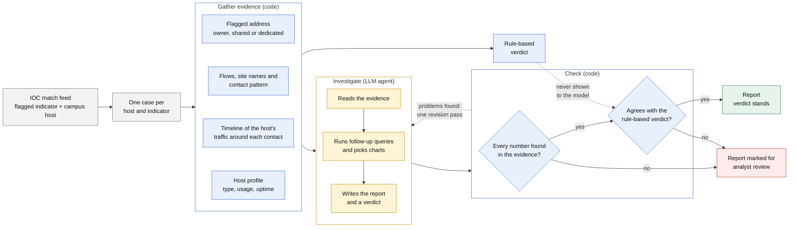
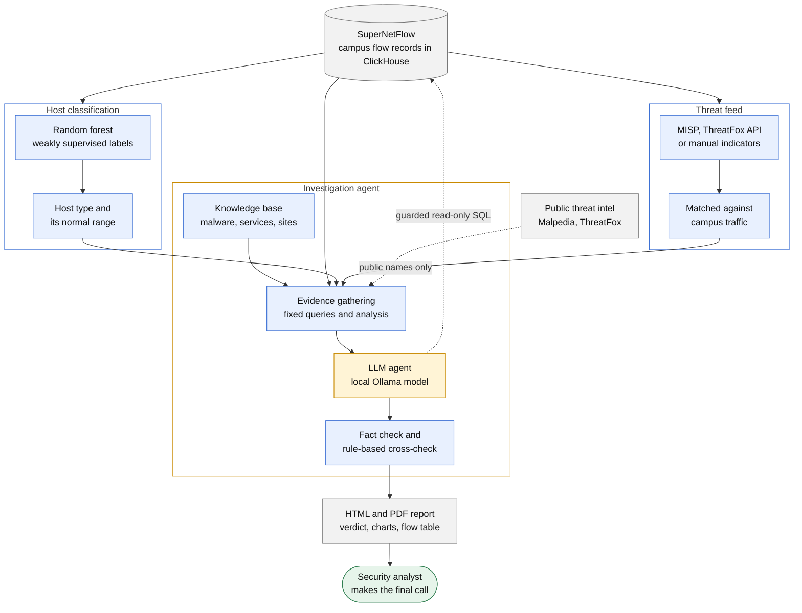

# Automated IOC Investigator

An LLM agent that investigates threat-intelligence alerts on a campus network
and writes the incident report an analyst would.

When a campus host contacts an address or domain on a threat-intelligence
list (a local [MISP](https://www.misp-project.org) that combines public feeds,
[ThreatFox](https://threatfox.abuse.ch) among them, or an analyst's own
indicators), most matches turn out to be noise: a
CDN address shared by thousands of sites, an ad pulled in by a web page, a
tunnel client doing exactly what it was installed for. This project works
through each match the way an analyst would. It pulls the host's flow records
from SuperNetFlow (ClickHouse), works out what the host was actually doing,
and writes a report with a verdict, charts and the evidence behind it.

Three design choices keep the reports trustworthy:

- **Evidence first, in code.** Everything that must be checked runs in Python
  before the model sees the case. A small local model skipped optional tools
  almost every time, so it gets the results instead of being trusted to fetch
  them.
- **The model reviews blind.** A rule-based verdict is computed from the same
  evidence but never shown to the model; when it was shown, the model just
  agreed with it. Where they disagree, an analyst decides.
- **Nothing unverified slips through.** Every number in a report is checked
  against the evidence, along with claims like "exfiltration" or "not shared
  infrastructure". Anything that fails is flagged for review, never quietly
  rewritten.

The model has no internet access. Code looks up public context for each case
in curated sources (Malpedia's description of the malware family, ThreatFox's
listing of the indicator), sending only those public names, and the report
cites them; `WEB_CONTEXT=0` turns this off. With a local Ollama model no flow
data leaves the network (see [Cloud model provider](#cloud-model-provider) for the
alternative).

## How it works



Each alert becomes a case: one campus host and one indicator. Steps 2 to 9
run in code before the model sees anything, and the model only gets the
evidence from steps 2 to 8. The rule-based verdict from step 9 is kept back
for the final check.

| # | Step | Who | Where |
|---|---|---|---|
| 1 | Group the feed into cases, one per host and indicator; merge duplicate visits and note domains shared across cases | Code | `evidence.py`, `correlation.py` |
| 2 | Identify the flagged address: its owner and whether it's shared infrastructure | Code | `tools.identify_server_ips`, `tools.ip_asn` |
| 3 | Set the expected behaviour: threat type, malware family (or an analyst's threat briefing) and known services such as tunnels; look up the family and the indicator in Malpedia and ThreatFox | Code | `tools.expected_behaviour`, `knowledge.py`, `web_context.py` |
| 4 | Analyse the contact: flows, the site names the host used, and whether it looks like a beacon, a held-open tunnel or a one-off | Code | `tools.indicator_flows`, `tools.indicator_names`, `beacon.py` |
| 5 | Build a timeline of everything the host did in the minutes around each contact | Code | `timeline.py` |
| 6 | Profile the host: what it's used for, its uptime, apps and DNS behaviour | Code | `tools.host_other_traffic`, `analysis.activity_profile`, `tools.host_dns_behaviour` |
| 7 | Classify the host and compare it with typical hosts of its type | Code | `host_type.py`, `host_classification/` |
| 8 | Look campus-wide: other hosts on the address and every site seen on it | Code | `tools.indicator_peers`, `tools.names_on_ip` |
| 9 | Compute signals and a rule-based baseline verdict | Code | `signals.py` |
| 10 | Investigate: read the evidence, run follow-up queries, pick charts, write the report and a verdict | Agent | `assess.py`, `tools.py`, `charts.py` |
| 11 | Check the report against the evidence and the baseline; send problems back for one revision, then flag anything that still fails | Code | `assess.py` |
| 12 | Write the HTML, Markdown and PDF reports | Code | `report.py`, `latex.py` |

## Architecture



- **Host classification** labels campus hosts (workstation, NAT gateway, web
  server, ...) with a random forest trained on weakly supervised labels, and
  measures what's normal for each type. See
  [host_classification/](host_classification/README.md).
- **Threat feed** (`build_feed.py`) pulls indicators from a local MISP, or
  takes an analyst's indicators and threat description, and finds the campus
  hosts that contacted them (`agent/matcher.py`).
- **Investigation agent** (`assess.py`, `agent/`) gathers the evidence, runs
  the model and checks what it writes.

## The report

Each case gets a short report written for the security team:

- **Executive summary**: what happened, the verdict and the one thing to do.
- **Background**: what the host appears to be and who likely uses it, judged
  from its own traffic (personal browsing such as entertainment, gaming or
  streaming points to a student's device); what the threat is; and what an
  infected host would look like.
- **Analysis**: a timestamped walk through the evidence that cites the
  connections it relies on and weighs the benign explanation against the
  malicious one.
- **Conclusion and next steps**: verdict, confidence, remaining risk and
  what to do about this host.

Below it sit the charts the model chose and a table of every connection
around the contact, each with a note on what it most likely was. That table
is what separates, say, a flagged ad domain loaded in the same minute as a
busy ad-funded site from a lone connection at 3 am.

Each report comes as a page in `report.html`, a Markdown file and, with
`--pdf`, a PDF whose one-page body is followed by an appendix of the figures,
the flow table, the case facts and its sources. The threat background can
draw on Malpedia's description of the malware family and the indicator's
ThreatFox listing, both cited.

## Getting started

You'll need Python 3.11+, read access to a SuperNetFlow ClickHouse database,
[Ollama](https://ollama.com) with a tool-calling model (or an OpenRouter key),
and for the threat feed a local MISP and an abuse.ch key. PDF reports need
[tectonic](https://tectonic-typesetting.github.io) or a TeX distribution with
`latexmk`; without one the reports are written as `.tex` files only.

```bash
python3 -m venv .venv && source .venv/bin/activate
pip install -r requirements.txt
pip install -r requirements-demo.txt   # optional: the stand dashboard
cp .env.example .env                   # ClickHouse, MISP, abuse.ch, model and site settings
ollama pull qwen3.5:9b
brew install tectonic                  # optional: PDF reports
```

Every setting is listed in `.env.example` with a placeholder. The agent asks
Ollama for a 32k-token context (`OLLAMA_NUM_CTX`): Ollama's 4k default
silently cuts off the start of the prompt.

### A full run

```bash
python sync_threatfox.py --days 1                         # ThreatFox's latest IOCs into MISP
python build_feed.py --source misp --days 7               # campus hosts that contacted them -> data/misp_matches.jsonl
python assess.py data/misp_matches.jsonl --limit 5 --pdf  # investigate and write the reports
python -m demo.anonymise output/assessments.json          # optional: the anonymised stand bundle
streamlit run dashboard/app.py                            # optional: the dashboard, http://localhost:8501
```

Results land in `output/`: `report.html` with every case (worst first,
filterable), a Markdown report and a PDF per case in `output/cases/`, a batch
`summary.pdf`, and `assessments.json` with everything, including token use.
They contain internal IPs and per-host activity, so they're gitignored.

`assess.py` takes any feed of matches (JSON or JSON Lines):

```bash
python assess.py data/misp_matches.jsonl --indicator bore.pub  # one indicator
python assess.py data/misp_matches.jsonl --limit 5 --resume    # the next five, keeping earlier results
python assess.py data/sample/ioc_matches_sample.json           # fake sample feed
```

Without `--resume`, a run replaces `output/assessments.json`.

### Building a feed from MISP

Run a local MISP with [misp-docker](https://github.com/MISP/misp-docker),
enable the public feeds you want (Feeds → "Load default feed metadata"), and
create an auth key. Put `MISP_URL` and `MISP_KEY` in `.env`; the local
instance's self-signed certificate is accepted unless `MISP_VERIFY_SSL=1`.

ThreatFox's bulk exports fail and MISP's built-in ThreatFox feeds need a key,
so ThreatFox comes in through its API instead, keeping its malware and
threat-type labels (needs `ABUSECH_AUTH_KEY` and a MISP key with write access):

```bash
python sync_threatfox.py --days 1 --dry-run                               # count only, write nothing
python build_feed.py --source misp --refresh                              # ask MISP to fetch its feeds first
python build_feed.py --source misp --feeds "ThreatFox,Phishing feeds"     # only some feeds
```

`build_feed.py` takes the IP, IP:port, domain, hostname and URL attributes
whose attribute timestamp is in the last N days (URLs are reduced to their
host), skips values on MISP's warninglists, and searches campus traffic for
them in windows of at most 5 days. Each match records its feed (the MISP
event's title, or "ThreatFox"). Records keep the old feed format with an
`intel` block in place of `threatfox` (see [docs/schema.md](docs/schema.md));
older feeds still load.

### Manual indicators and a threat description

For a new threat that no feed lists yet, such as an email about a new CVE:

```bash
python build_feed.py --source manual --indicator 203.0.113.7 --indicator example.test \
    --threat-file threat.txt --out data/manual_matches.jsonl
python assess.py data/manual_matches.jsonl --pdf
```

One model call turns the description into a threat briefing (what an affected
host's traffic looks like, what a false positive looks like, CVEs, references),
saved in `data/threat_briefings/` and shown for you to confirm (`--yes` skips
that). The investigation then uses it in place of the built-in knowledge base,
labelled as an analyst-supplied description. `--push-misp` also saves the
indicators as a MISP event (needs `MISP_WRITE_KEY`).

### PDF reports

`--pdf` writes each case as LaTeX (`output/cases/<case>.tex`, with its charts
as vector PDFs) plus a batch overview (`output/summary.tex`), and compiles
them with `latexmk` or `tectonic`, whichever is installed. The layout follows
the hand-written CyberShield reports: a one-page body (the self-check asks the
model to tighten a report over about 750 words), then an appendix with the
figures, the flow table, the case facts and a closing line of sources and
limits, all referred to by number from the body.

To compile reports from a run made without a TeX engine, without running the
model again:

```bash
python -m agent.latex output/assessments.json
```

### Dashboard and stand demo

```bash
streamlit run dashboard/app.py                     # real details, for the security team
ANONYMISE=1 streamlit run dashboard/app.py         # anonymised
DEMO_ONLY=1 streamlit run dashboard/app.py         # the event stand: anonymised, replay only
```

- **Threat board**: cases this week, likely threats against false positives,
  the top threat types, and a table of recent cases (newest first, filtered by
  verdict, threat type and source). Click a row for its report, charts and PDF,
  shown inline or opened in its own tab. Beside it, the newest ThreatFox
  malware families and MISP events, from a snapshot of public data.
- **Feeds** (sidebar): ThreatFox, each MISP feed by name and the phishing
  feeds as one group, each with its case count. The ticks filter the board;
  in live mode they also choose which feeds a pull matches against (ThreatFox's
  API is only called when ThreatFox is ticked).
- **How it works**: the pipeline, replayed step by step for a recorded case.
- **Try it**: indicators and a threat description in, a report out.

The dashboard listens on localhost only. By default it reads
`output/assessments.json` and its PDFs as they are. With `ANONYMISE=1`, and
always with `DEMO_ONLY=1`, it shows the anonymised bundle instead, built by
`python -m demo.anonymise output/assessments.json`: campus addresses become
Host A, Host B, host names become role labels, visited sites become
"streaming site 2" and the like, and public indicators stay. Building the
bundle needs `CAMPUS_CIDR` and `CAMPUS_DOMAINS` in `.env`, and a TeX engine for
its PDFs. Without a bundle, a fake sample set in `demo/sample/` is shown.

Demo mode (the default) only replays recorded cases and makes no network
calls, so it works on venue Wi-Fi or none. Live mode (a sidebar toggle, hidden
by `DEMO_ONLY=1`) runs the pipeline and needs the database and the model.

### Cloud model provider

With `LLM_PROVIDER=openrouter`, case files (which hold internal IPs and per-host
activity) are sent off-network to OpenRouter and the model's provider. The
supervisor has approved this. Each case records its token use and cost, the run
totals go into `assessments.json`, `MAX_RUN_COST_USD` stops a batch cleanly at a
spending limit, and running out of credit stops the batch rather than failing
each case. With an `anthropic/*` model the system prompt and case file are
marked for prompt caching (`PROMPT_CACHE=0` turns it off).

## Evaluation

`eval/run_eval.py` runs the agent on cases with an expected verdict and
compares the expected, rule-based and model verdicts side by side.

```bash
python eval/run_eval.py                                        # quick sample
python eval/run_eval.py --all --repeat 2                       # everything, twice, to check consistency
python eval/run_eval.py --from-output output/assessments.json  # re-score a saved run, no model calls
```

## Project layout

```
assess.py               runs each case: evidence, model, checks, report
build_feed.py           builds a feed from MISP or manual indicators
sync_threatfox.py       copies ThreatFox IOCs into MISP with their labels
agent/
  misp_feed.py          reads indicators from MISP as intel blocks
  matcher.py            finds campus contacts and writes match records
  briefing.py           threat description -> briefing (one model call)
  web_context.py        public threat intel: Malpedia and ThreatFox lookups
  latex.py              LaTeX/PDF reports
  tools.py, db.py       evidence queries and the model's guarded tools
  analysis.py           flow analysis: contact pattern, timelines, usage
  beacon.py, timeline.py
  signals.py            rule-based signals and the baseline verdict
  casefile.py           the evidence as the model reads it
  knowledge.py          malware, service and site profiles
  llm_client.py         Ollama / OpenRouter client with a tool loop
  charts.py, report.py  charts (SVG and PDF) and the HTML and Markdown reports
  mdrender.py           the model's Markdown, safely rendered as HTML
host_classification/    host-type classifier and per-type profiles
dashboard/              Streamlit dashboard (threat board, pipeline replay, try it)
demo/                   anonymiser, intel snapshot and a fake sample bundle
eval/                   verdict evaluation
docs/                   design notes and the data schema
```

## Limitations

- Flow records only: there are no payloads, so what was inside a session is
  unknown.
- Per-minute data is kept for about 15 days; older cases rely on large flows
  and the feed's own rows.
- Threat context comes from a local knowledge base and two curated public
  sources (Malpedia, ThreatFox); there is no open web search.
- Thresholds for "rare", "popular" and "exfiltration-sized" are judgement
  calls.
- A report is a first assessment for an analyst to confirm, not a final
  answer.

For the full list of signals, checks and tools, see
[docs/how-it-works.md](docs/how-it-works.md).

## Future improvements

The agent only investigates what the feed hands it. That has two
consequences:

- **It only knows what's already been reported.** Public feeds are
  community-driven, so coverage leans towards some malware families, new
  infrastructure appears only after someone spots and submits it, and many
  entries are shared addresses (CDNs, cloud hosting) that match plenty of
  innocent traffic.
- **It can't find what nobody has listed.** A host talking to a command
  server that isn't on any list never becomes a case, however strange its
  traffic looks.

Two natural next steps:

- **Web context for threat briefings.** Let the briefing step search the web
  for a threat's public name, CVE or indicator (a few searches, never campus
  addresses) and cite what it found, beyond the curated Malpedia and ThreatFox
  lookups.
- **An anomaly detection flow.** Much of the groundwork exists: per-type
  profiles of normal host behaviour and a per-minute beacon detector. Running
  those across all campus hosts, rather than only flagged ones, would raise
  cases with no indicator at all, which the same agent could then
  investigate.
