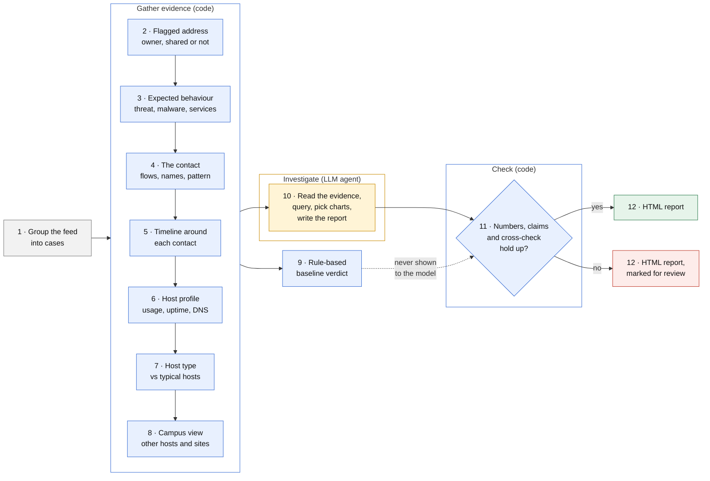
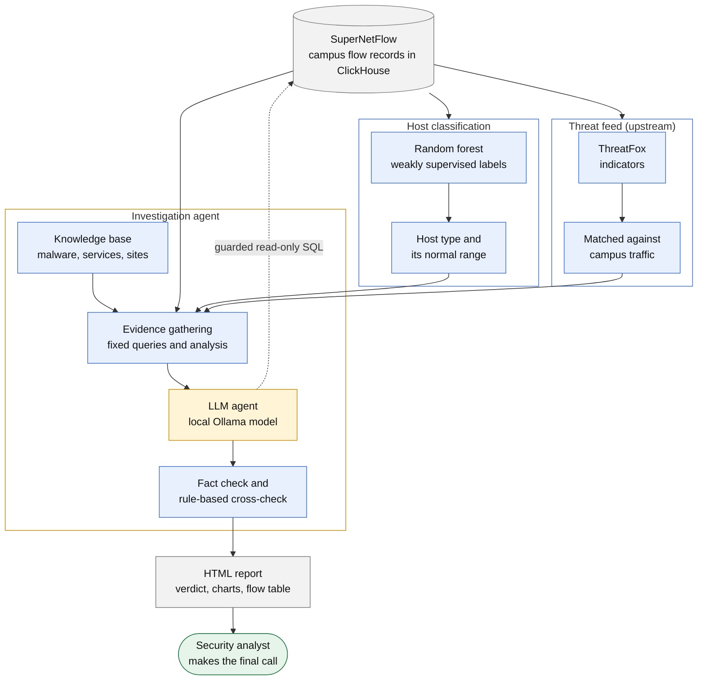

# Automated IOC Investigator

An LLM agent that investigates threat-intelligence alerts on a campus network
and writes the incident report an analyst would.

When a campus host contacts an address or domain listed on
[ThreatFox](https://threatfox.abuse.ch), most matches turn out to be noise: a
CDN address shared by thousands of sites, an ad pulled in by a web page, a
tunnel client doing exactly what it was installed for. This project works
through each match the way an analyst would. It pulls the host's flow records
from SuperNetFlow (ClickHouse), works out what the host was actually doing,
and writes a report with a verdict, charts and the evidence behind it.

Three design choices keep the reports trustworthy:

- **Evidence first, in code.** Everything that must be checked runs in Python
  before the model sees the case. A small local model skipped optional tools
  almost every time, so it gets the results instead of being trusted to fetch
  them.
- **The model reviews blind.** A rule-based verdict is computed from the same
  evidence but never shown to the model; when it was shown, the model just
  agreed with it. Where they disagree, an analyst decides.
- **Nothing unverified slips through.** Every number in a report is checked
  against the evidence, along with claims like "exfiltration" or "not shared
  infrastructure". Anything that fails is flagged for review, never quietly
  rewritten.

The agent has no internet access, and with a local Ollama model no flow data
leaves the network.

## How it works



Each alert becomes a case: one campus host and one indicator. Steps 2 to 9
run in code before the model sees anything, and the model only gets the
evidence from steps 2 to 8. The rule-based verdict from step 9 is kept back
for the final check.

| # | Step | Who | Where |
|---|---|---|---|
| 1 | Group the feed into cases, one per host and indicator; merge duplicate visits and note domains shared across cases | Code | `evidence.py`, `correlation.py` |
| 2 | Identify the flagged address: its owner and whether it's shared infrastructure | Code | `tools.identify_server_ips`, `tools.ip_asn` |
| 3 | Set the expected behaviour: threat type, malware family and known services such as tunnels | Code | `tools.expected_behaviour`, `knowledge.py` |
| 4 | Analyse the contact: flows, the site names the host used, and whether it looks like a beacon, a held-open tunnel or a one-off | Code | `tools.indicator_flows`, `tools.indicator_names`, `beacon.py` |
| 5 | Build a timeline of everything the host did in the minutes around each contact | Code | `timeline.py` |
| 6 | Profile the host: what it's used for, its uptime, apps and DNS behaviour | Code | `tools.host_other_traffic`, `analysis.activity_profile`, `tools.host_dns_behaviour` |
| 7 | Classify the host and compare it with typical hosts of its type | Code | `host_type.py`, `host_classification/` |
| 8 | Look campus-wide: other hosts on the address and every site seen on it | Code | `tools.indicator_peers`, `tools.names_on_ip` |
| 9 | Compute signals and a rule-based baseline verdict | Code | `signals.py` |
| 10 | Investigate: read the evidence, run follow-up queries, pick charts, write the report and a verdict | Agent | `assess.py`, `tools.py`, `charts.py` |
| 11 | Check the report against the evidence and the baseline; send problems back for one revision, then flag anything that still fails | Code | `assess.py` |
| 12 | Write the HTML and Markdown reports | Code | `report.py` |

## Architecture



- **Host classification** labels campus hosts (workstation, NAT gateway, web
  server, ...) with a random forest trained on weakly supervised labels, and
  measures what's normal for each type. See
  [host_classification/](host_classification/README.md).
- **Threat feed** comes from upstream: ThreatFox indicators already matched
  against campus traffic.
- **Investigation agent** (`assess.py`, `agent/`) gathers the evidence, runs
  the model and checks what it writes.

## The report

Each case gets a short report written for the security team:

- **Executive summary**: what happened, the verdict and the one thing to do.
- **Background**: what the host appears to be and who likely uses it, judged
  from its own traffic (personal browsing such as entertainment, gaming or
  streaming points to a student's device); what the threat is; and what an
  infected host would look like.
- **Analysis**: a timestamped walk through the evidence that cites the
  connections it relies on and weighs the benign explanation against the
  malicious one.
- **Conclusion and next steps**: verdict, confidence, remaining risk and
  what to do about this host.

Below it sit the charts the model chose and a table of every connection
around the contact, each with a note on what it most likely was. That table
is what separates, say, a flagged ad domain loaded in the same minute as a
busy ad-funded site from a lone connection at 3 am.

## Getting started

You'll need Python 3.11+, read access to a SuperNetFlow ClickHouse database,
and [Ollama](https://ollama.com) with a tool-calling model (or an OpenRouter
key).

```bash
python3 -m venv .venv && source .venv/bin/activate
pip install -r requirements.txt
cp .env.example .env      # ClickHouse login, model and site settings
ollama pull qwen3.5:9b
```

Then point it at a feed of matches (JSON or JSON Lines):

```bash
python assess.py data/ioc_matches.jsonl                       # every case
python assess.py data/ioc_matches.jsonl --indicator bore.pub  # one indicator
python assess.py data/ioc_matches.jsonl --limit 5             # a batch, then --resume
python assess.py data/sample/ioc_matches_sample.json          # fake sample feed
```

Results land in `output/`: `report.html` with every case (worst first,
filterable), a Markdown report per case with its charts, and
`assessments.json` with everything. They contain internal IPs and per-host
activity, so they're gitignored.

A couple of things worth knowing:

- The agent asks Ollama for a 32k-token context (`OLLAMA_NUM_CTX`). Ollama's
  4k default silently cuts off the start of the prompt.
- Every setting lives in `.env.example`, with placeholders.

## Evaluation

`eval/run_eval.py` runs the agent on cases with an expected verdict and
compares the expected, rule-based and model verdicts side by side.

```bash
python eval/run_eval.py                                        # quick sample
python eval/run_eval.py --all --repeat 2                       # everything, twice, to check consistency
python eval/run_eval.py --from-output output/assessments.json  # re-score a saved run, no model calls
```

## Project layout

```
assess.py               runs each case: evidence, model, checks, report
agent/
  tools.py, db.py       evidence queries and the model's guarded tools
  analysis.py           flow analysis: contact pattern, timelines, usage
  beacon.py, timeline.py
  signals.py            rule-based signals and the baseline verdict
  casefile.py           the evidence as the model reads it
  knowledge.py          malware, service and site profiles
  llm_client.py         Ollama / OpenRouter client with a tool loop
  charts.py, report.py  SVG charts and the HTML and Markdown reports
host_classification/    host-type classifier and per-type profiles
eval/                   verdict evaluation
docs/                   design notes and the data schema
```

## Limitations

- Flow records only: there are no payloads, so what was inside a session is
  unknown.
- Per-minute data is kept for about 15 days; older cases rely on large flows
  and the feed's own rows.
- Malware and service context comes from a local knowledge base, not live
  research.
- Thresholds for "rare", "popular" and "exfiltration-sized" are judgement
  calls.
- A report is a first assessment for an analyst to confirm, not a final
  answer.

For the full list of signals, checks and tools, see
[docs/how-it-works.md](docs/how-it-works.md).
