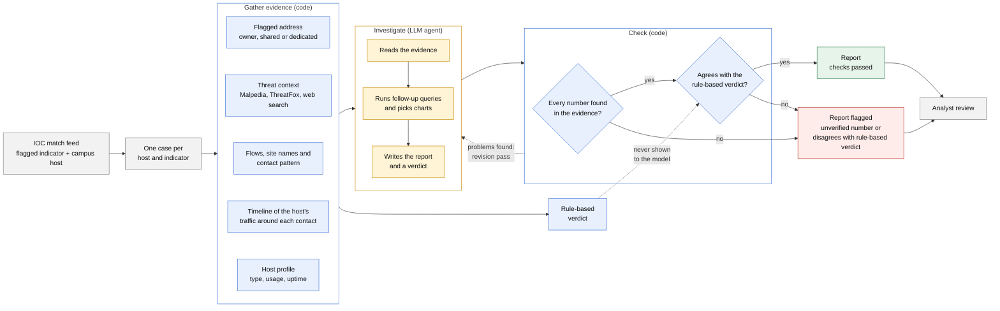
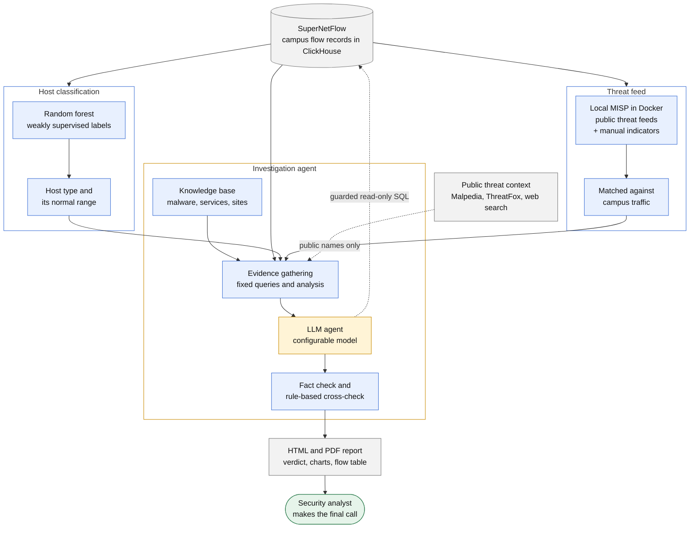

# Automated IOC Investigator

An LLM agent that investigates threat-intelligence alerts on a campus network
and writes the incident report an analyst would.

Indicators come from our own [MISP](https://www.misp-project.org) instance,
run in Docker with [misp-docker](https://github.com/MISP/misp-docker). It
aggregates public threat feeds, among them the Threatview.io IP blocklist,
domain blocklist and C2 Hunt feed, PhishTank, URL Seen in honeypots and
[ThreatFox](https://threatfox.abuse.ch), plus analysts' own indicators.
When a campus host contacts a listed address or domain, most matches turn
out to be noise: a CDN address shared by thousands of sites, an ad pulled in
by a web page, a tunnel client doing exactly what it was installed for. This project works through each match the
way an analyst would. It pulls the host's flow records from SuperNetFlow
(ClickHouse), works out what the host was actually doing, and writes a report
with a verdict, charts and the evidence behind it.

Three design choices keep the reports trustworthy:

- **Evidence first, in code.** Everything that must be checked runs in Python
  before the model sees the case, so the model works from complete evidence
  instead of being trusted to fetch it.
- **The model reviews blind.** A rule-based verdict is computed from the same
  evidence but never shown to the model; when it was shown, the model just
  agreed with it. Where they disagree, the report is flagged so the analyst
  looks at that point closely.
- **Nothing unverified slips through.** Every number in a report is checked
  against the evidence, along with claims like "exfiltration" or "not shared
  infrastructure". Anything that fails is flagged for the analyst, never
  quietly rewritten.

Outside context about the threat comes from code, not from the model browsing:
Malpedia's description of the malware family, the indicator's ThreatFox
listing and a short web search (at most three searches per indicator). Only
public names are sent (the indicator, malware family, threat type and feed),
never a campus address or host name, and the report cites its sources.

## How it works



Each alert becomes a case: one campus host and one indicator. Steps 2 to 9
run in code before the model sees anything, and the model only gets the
evidence from steps 2 to 8. The rule-based verdict from step 9 is kept back
for the final check.

| # | Step | Who | Where |
|---|---|---|---|
| 1 | Group the feed into cases, one per host and indicator; merge duplicate visits and note domains shared across cases | Code | `evidence.py`, `correlation.py` |
| 2 | Identify the flagged address: its owner and whether it's shared infrastructure | Code | `tools.identify_server_ips`, `tools.ip_asn` |
| 3 | Set the expected behaviour: threat type, malware family (or an analyst's threat briefing) and known services such as tunnels; look up outside context in Malpedia, ThreatFox and a short web search, sending public names only | Code | `tools.expected_behaviour`, `knowledge.py`, `web_context.py` |
| 4 | Analyse the contact: flows, the site names the host used, which side each port belongs to, and whether it looks like a beacon, a held-open tunnel or a one-off | Code | `tools.indicator_flows`, `tools.indicator_names`, `beacon.py` |
| 5 | Build a timeline of everything the host did in the minutes around each contact | Code | `timeline.py` |
| 6 | Profile the host: what it's used for, its uptime, apps and DNS behaviour | Code | `tools.host_other_traffic`, `analysis.activity_profile`, `tools.host_dns_behaviour` |
| 7 | Classify the host and compare it with typical hosts of its type | Code | `host_type.py`, `host_classification/` |
| 8 | Look campus-wide: other hosts on the address and every site seen on it | Code | `tools.indicator_peers`, `tools.names_on_ip` |
| 9 | Compute signals and a rule-based baseline verdict | Code | `signals.py` |
| 10 | Investigate: read the evidence, run follow-up queries, pick charts, write the report and a verdict | Agent | `assess.py`, `tools.py`, `charts.py` |
| 11 | Check the report against the evidence and the baseline; send problems back for revision, then flag anything that still fails | Code | `assess.py` |
| 12 | Write the HTML, Markdown and PDF reports | Code | `report.py`, `latex.py` |

## Architecture



- **Host classification** labels campus hosts (workstation, NAT gateway, web
  server, ...) with a random forest trained on weakly supervised labels, and
  measures what's normal for each type. See
  [host_classification/](host_classification/README.md).
- **Threat feed** (`build_feed.py`): MISP runs locally in Docker and pulls
  many public feeds. ThreatFox comes in through its API (`sync_threatfox.py`)
  because MISP's own ThreatFox feeds need a key. The feed build can also take
  an analyst's indicators and threat description, and finds the campus hosts
  that contacted them (`agent/matcher.py`).
- **Investigation agent** (`assess.py`, `agent/`) gathers the evidence, runs
  the model and checks what it writes. The model is set in `.env`: a hosted
  model through OpenRouter (Claude Haiku in current use) or a local Ollama
  model, which keeps all flow data on the network.

## The report

Each case gets a short report written for the security team:

- **Executive summary**: what happened, the verdict and the one thing to do.
- **Background**: what the host appears to be and who likely uses it, judged
  from its own traffic; what the threat is; and what an affected host would
  look like.
- **Analysis**: a timestamped walk through the evidence that cites the
  connections it relies on and weighs the benign explanation against the
  malicious one.
- **Conclusion and next steps**: verdict, confidence, remaining risk and
  what to do about this host.

The PDF keeps the body to one page, followed by an appendix with the charts
the model chose, a table of every connection around the contact (each with a
note on what it most likely was), the case facts and the sources. That table
is what separates, say, a flagged ad domain loaded in the same minute as a
busy ad-funded site from a lone connection at 3 am.

## Quick start

```bash
python3 -m venv .venv && source .venv/bin/activate
pip install -r requirements.txt
cp .env.example .env                                      # database, MISP, model and site settings

# start MISP first: docker compose up -d (in your misp-docker folder)
python sync_threatfox.py --days 1                         # ThreatFox's latest IOCs into MISP
python build_feed.py --source misp --days 7               # campus hosts that contacted them
python assess.py data/misp_matches.jsonl --limit 5 --pdf  # investigate and write the reports
streamlit run dashboard/app.py                            # optional dashboard, http://localhost:8501
```

Finished PDFs land in `output/reports/`. `output/` and `data/` hold internal
addresses and per-host activity, so both are gitignored. Setup details, feed
options, manual indicators, PDFs, the dashboard, model providers and cost
limits are in [docs/usage.md](docs/usage.md); the full list of signals, checks
and tools is in [docs/how-it-works.md](docs/how-it-works.md).

## Limitations

- Flow records only: there are no payloads, so what was inside a session is
  unknown.
- Per-minute data is kept for about 15 days; older cases rely on large flows
  and the feed's own rows.
- Web context is external and unverified: the report must cite it, and flow
  data outranks it.
- Thresholds for "rare", "popular" and "exfiltration-sized" are judgement
  calls.
- A report is a first assessment for an analyst to confirm, not a final
  answer.

## Future improvements

The agent only investigates what the feed hands it, so it only knows what has
already been reported and can't find a command server that nobody has listed.
The natural next step is an **anomaly detection flow**: much of the groundwork
exists (per-type profiles of normal host behaviour and a per-minute beacon
detector). Running those across all campus hosts, rather than only flagged
ones, would raise cases with no indicator at all, which the same agent could
then investigate.
