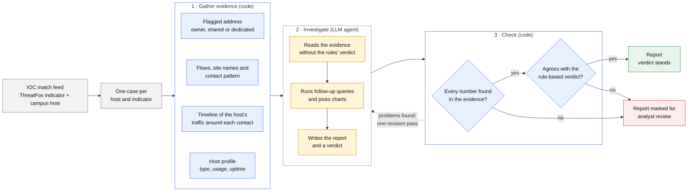

# IOC Investigation Agent

An LLM agent that investigates IOC matches on a campus network. It reads a
feed of IOC matches (each one a [ThreatFox](https://threatfox.abuse.ch)
indicator plus the internal host that contacted it), gathers the host's flow
records from SuperNetFlow in ClickHouse, and hands the evidence to the model,
which runs its own follow-up queries, picks 1-3 charts, and writes the report
and verdict. Code checks the report against the evidence and against a
rule-based baseline verdict. It writes an HTML report and one Markdown report
per case.

The agent has no internet access. It works only from the feed, ClickHouse and
a local knowledge base of threat, malware and service profiles.

## How it works



## Architecture


## Workflow

Each case follows the same ten steps. "Auto" steps are plain Python and always
run. "Agent" steps are the LLM reasoning over the evidence; it can also call
follow-up tools (below).

| # | Step | Who | Where |
|---|---|---|---|
| 1 | Group the feed by (indicator, host) | Auto | `evidence.group_matches` |
| 2 | Read the IOC context: type, malware, threat type, confidence | Auto | `evidence.case_identity` |
| 3 | Identify every flagged IP, its ASN and whether it is shared infrastructure | Auto | `tools.identify_server_ips`, `tools.ip_asn` |
| 4 | Set expected behaviour: threat type, malware family, known services; domain features | Auto | `tools.expected_behaviour`, `tools.domain_features`, `knowledge.py` |
| 5 | Analyse flows between host and flagged IP, the names (SNI/DNS) the host used on it, the per-minute contact pattern, and app labels | Auto | `tools.indicator_flows`, `tools.indicator_names`, `tools.beacon_analysis`, `tools.app_context_for_indicator`, `beacon.py` |
| 1b | What the host is used for: its traffic by kind of use (adult content, gaming, streaming, study help, work tools) with volumes, shares and main sites, plus its busiest unlisted sites for the model to judge by name | Auto | `analysis.activity_profile`, `knowledge.HOST_ACTIVITY_HINTS` |
| 5e | Flow timeline: the host's traffic from 5 min before to 2 min after the first, largest and last contact episodes, one row per site and per flagged address (lead-in and known kinds first), rows F1, F2, ... | Auto | `timeline.py` |
| 6 | Compare with expected compromised behaviour, investigating further with its own queries | Agent | prompt in `assess.py`, follow-up tools |
| 7 | Compare with the host's traffic to other IPs: apps, user-agent platform, DNS behaviour, load and uptime | Auto + agent | `tools.host_other_traffic`, `tools.host_applications`, `tools.host_dns_behaviour`, `tools.host_load_baseline` |
| 7b | Classify the host (workstation, NAT gateway, web server, ...) and compare it with typical hosts of that type | Auto + agent | `agent/host_type.py`, `host_classification/` |
| 8 | Other internal hosts on the flagged IP, and every name on it campus-wide (one day per query) | Auto | `tools.indicator_peers`, `tools.names_on_ip` |
| 9 | Signals, behaviour category and baseline verdict (code); the model's own verdict | Auto + agent | `signals.py`, `behaviour.py`, `assess.py` |
| 10 | Write the report, with 1-3 charts the model chooses; code checks it | Agent + auto | `assess.py`, `charts.py`, `report.py` |

The model writes the report, in four parts:

- **Executive summary**: three to five sentences: what happened, what the
  host appears to be, the verdict and main reason, and the one thing to do.
- **Background**, in three parts: *The host* (its type, normal behaviour and
  uptime, and what kind of device it likely is and who uses it, inferred from
  its activity, e.g. adult sites, games and streaming point to a student's
  personal device); *The threat* (what the IOC is and why it matters); *What
  an affected host looks like* (expected flow behaviour, the yardstick for
  the analysis).
- **Analysis**: a breakdown of the evidence behind the verdict, with
  subheadings: when the contacts happened (exact times), what the host was
  doing around them from the flow timeline (e.g. a flagged ad domain in the
  same minute as an adult site and ad exchanges is a pop-up ad), how that
  compares with an affected host and with the host's normal traffic, and what
  decides it, with its charts. It cites timeline rows as `[[flow F3]]`, which
  become links to the flow table.
- **Conclusion and next steps**: verdict and confidence, remaining risk, what
  the evidence cannot show, numbered steps specific to the host.

The model also gives `LIKELY_USER` (student, staff or unclear, and the
activity behind it): personal use such as pornography, games or streaming, or
study-help sites, points to a student; workplace tools with no personal use
to staff. Code checks it against the host's kinds of use
(`knowledge.USER_EVIDENCE`) and shows it in the case's facts box.

Before the report, the model writes `FLOW_NOTES`: a few words per timeline
row on what the connection most likely is. The report ends with two folded
sections: **Figures** (the charts it chose) and **Flows around the flagged
contact**, a table of the timeline rows (time, duration, host → remote
IP:port, up/down bytes, a factual description of the remote end, and the
model's note).

The prompt says what each part covers and asks for an analyst's own words
and specific facts (times, names, ports, volumes, comparisons), not a
template to fill in. Every report is the model's own writing, including
cases with no traffic (code records those as INSUFFICIENT_DATA, and the number
check catches any traffic detail the model invents). Code never writes report
text: it checks the report (below), and a missing or incomplete report is shown
as written and marked for review. The charts the model chose are collected in
a collapsible **Figures** section at the end; where the model placed one, the
text links to it. Long chart labels wrap onto extra lines rather than being
cut short.

Each case gets a **behaviour category** (`agent/behaviour.py`): tunnelling,
remote access, connection to a tunnel's public port, C2-like beaconing,
persistent connection to an unrecognised service, file download, web visit
to the flagged site, web browsing through shared infrastructure, other, or no
traffic. It is shown as a label on the case; the model does not see it.

Checks that must always happen are run in Python, not left to the model: in
testing, a small local model skipped optional tools almost every time.

Step 5 separates a **held-open connection** (a few flows lasting hours or days
at a steady packet rate, e.g. a tunnel) from **repeated short check-ins** (many
brief flows at a regular interval, the real beacon pattern). Daily presence on
its own is never treated as beaconing.

When a live query finds nothing (usually because `subscriber_activity_1m`
keeps only about 15 days), the feed's own copy of the matched rows is used
instead, labelled "from the IOC feed, not re-queried".

### Signals and the baseline verdict

Before the model runs, `agent/signals.py` computes ten signals, each
`supports_threat` (strong or weak), `against_threat` or `neutral`, with a
one-line reason:

| Signal | Against threat when | Supports threat when |
|---|---|---|
| `shared_infrastructure` | CDN/cloud range or ASN, many campus hosts, many domains on the IP, or a known public service | One domain on the IP and not a shared ASN (weak) |
| `sni_matches_indicator` | The names the host used on the IP are ordinary sites | A name that is itself flagged, dynamic DNS, or rare and DGA-like (strong); rare, new, DGA-like or free hosting alone (weak). A domain indicator's own name in the traffic is neutral: it only confirms the contact the feed matched on |
| `protocol_fit` | QUIC (UDP/443) or TLS web browsing, for a custom-TCP family | TCP to a non-web port, for a custom-TCP family (weak) |
| `traffic_shape_fit` | A few short sessions (botnet_cc); a tiny transfer (payload_delivery) | Regular check-ins (strong); a payload-sized download (weak) |
| `contact_pattern` | One-off or human-like use (per-minute data); or a periodic/held-open pattern explained by a recognised app, session, known service or popular destination | Unexplained regular small check-ins day and night (strong) or an unexplained held-open connection (weak) |
| `app_explained` | SuperNetFlow labels the traffic as a known app, or it was part of a recognised app session | (never) |
| `dns_anomaly` | (never) | The host asks DNS servers few campus hosts use, or many of its queries go unanswered (weak) |
| `platform_fit` | Only other-OS signs, from user agents first, then OS domains | The host's user agents are mostly the targeted OS (weak) |
| `campus_spread` | Many campus hosts, none independently flagged | Peers flagged by *other* indicators for the same family (strong) |
| `known_service` | Only the service's own client ports | Other ports on the service (e.g. a tunnel's public port) (strong) |

ThreatFox confidence is not a signal: it rates the indicator, not the host.

The baseline verdict follows fixed rules (`signals.baseline_verdict`):

1. No traffic, live or in the feed: **INSUFFICIENT_DATA** (set in code, whatever the model says)
2. 2+ strong threat signals, or 1 strong + 2 weak: **LIKELY_THREAT**
3. 1 strong threat signal: **SUSPICIOUS**
4. Shared infrastructure, a known service's normal client or a recognised app, at most 2 weak threat signals: **LIKELY_FALSE_POSITIVE**
5. 2+ weak threat signals: **SUSPICIOUS**
6. Only signals against threat: **LIKELY_FALSE_POSITIVE** (low confidence)
7. Nothing either way: **SUSPICIOUS** (low confidence)

The model gets the objective evidence (the case file) but **not** the
signals, the behaviour category or the baseline: shown an answer, a model
tends to agree with it. Its verdict is the report's verdict, and the baseline
is a cross-check. The case is marked for human review, with both readings and
the rules' reason shown, when:

- the model's verdict differs from the baseline;
- the report quotes a number that is in neither the case file nor a tool
  result (charts' data summaries count as tool results);
- it claims exfiltration with no flow over the threshold, says the IP is not
  shared when the evidence says it is, or its headline says "does not match"
  but escalates;
- it talks about itself or how it was made (an agent, a model, "I", the case
  file, step numbers): the report is for the security team;
- the report is missing or incomplete (the code-written summary is shown
  instead).

`eval/run_eval.py` reports how often the model agrees with the rules.

**Self-check.** After its first report, the model gets it back with a
proofreading checklist (numbers in the evidence, verdict consistent with the
assessment, benign and malicious explanations weighed, remaining risk named,
host role backed by evidence, no reliance on ThreatFox confidence, 1-3 charts
placed, all four parts present, no SQL in the text, next steps given) plus
any problems code found, and may use the tools
again (e.g. to fix a chart) before returning the corrected report. The checks
never reveal the rules' verdict. One pass by default (`MODEL_REFINE_ROUNDS`, 0
to turn off).

### Cross-case links

After grouping, `agent/correlation.py` looks for a domain that sits behind two
or more different flagged indicators in the same feed. That is usually how the
indicator was reported: someone looked up a domain and submitted each of its
addresses (a Cloudflare site, for example, always has more than one). So the
link is **one note at the top of the report**, not evidence against any host:
"envoydev.co is behind 2 flagged addresses (normal for Cloudflare); the IOC was
probably reported against this domain. Check it on ThreatFox", with how many
campus hosts used it and when it first appeared.

- A case is marked for review for the link only when the host's own contact
  with the domain is more than one visit: repeated contact, non-web traffic or
  uploads.
- Cases whose site name was hidden (ECH) are not linked; the report just says
  which site was seen on that address.
- One host visiting one site through two flagged addresses is one visit: the
  duplicate is not assessed again, and one card covers both addresses.
- Each card gives one action: close it or review it, never both.

### Tools the model can call

All are bound to the case's host in code. The model is encouraged to query
wherever the case file leaves a question open or a point in its report needs
checking.

| Tool | Use |
|---|---|
| `timeline_around(time, minutes)` | Everything the host did around one time: a browsing burst or a lone connection? |
| `host_baseline(days)` | The host's normal daily volume, destinations and active hours |
| `compare_sessions(date_a, date_b)` | The host's traffic with the flagged IP on two dates |
| `run_sql(sql)` | Anything else: SELECT only, the tables in `docs/schema.md`, must filter on the host or a flagged server IP and a time column within the table's span (5 days per-minute, 30 days 5-minute, 90 days hourly), 50-row cap |
| `add_chart(title, sql, kind, x, y, ...)` | A chart for the report: the same SQL rules as `run_sql`, up to 2000 rows; `line` (time on x, up to 3 lines from y columns or a `series` column) or `bar` (one bar per row, up to 25; the case's host is highlighted). At most 3 per case; the model places each with `[[chart N]]` |

Up to `MAX_TOOL_ROUNDS` (default 12) rounds per case, several calls per round.
Every call is logged under the case in the report.

**Charts.** The model chooses 1-3 charts and places them in its text. Small
models rarely call tools, so most charts need none: the case file ends with
**ready-made charts** built from data the evidence step already fetched, each
with its key values, and the model places one by writing `[[chart host_load]]`:

| Chart | Shows |
|---|---|
| `contact` | Upload and download between the host and the flagged address over time |
| `host_load` | The host's total hourly traffic over two weeks, with the flagged contact marked |
| `sites_on_ip` | Every site seen on the flagged address by campus hosts, the host's own highlighted |
| `campus_hosts` | Campus hosts with large flows to the flagged address, this host highlighted |
| `destinations` | The host's busiest other destinations |
| `apps` | The host's traffic by app category |
| `host_vs_type` | Where the host sits among measured hosts of its type, per feature (needs built profiles) |

Each appears only when there is enough data. For anything else the model can
make its own with `add_chart`. If a report places no chart, the most telling
ready-made one is added to the Analysis. Charts are drawn as self-contained
SVG (`agent/charts.py`): no chart library or internet needed, light and dark
themes, a hover tooltip per point, and the data and source under each figure.

### Host type and its typical behaviour

Step 7b asks what kind of machine the host is, and whether it behaves like
one (`agent/host_type.py`, `host_classification/`). The host's own traffic
over the 7 days before the match (`HOST_TYPE_WINDOW_DAYS`) is turned into the
same features used campus-wide: volume and upload share, night-vs-day
volume, large-flow peers, ports, protocols and port groups, and how many apps
it uses. A random forest trained on hand-verified seed hosts labels it
(end host, NAT gateway, web server, web proxy, remote computing server, other
TCP server), or transparent rules do until a forest is trained. Each key
feature is then placed on its type's measured range (5th-95th percentile),
or on rough priors from `knowledge.py` until profiles are built.

The case file gives the model the type and how sure it is, which features
are unusual for the type, and from `knowledge.HOST_TYPE_PROFILES` what is
typical, what would be abnormal, what compromise looks like for that type,
and how to read an IOC match from it. For example, a match from a NAT gateway
means some device behind it made the contact. When measured profiles exist,
a ready-made chart shows where the host sits on each feature.

Build the classifier and profiles once (and again when the seeds change):

```bash
pip install scikit-learn
python -m host_classification build --start 2026-09-24 --end 2026-10-01
```

See [host_classification/README.md](host_classification/README.md).

## Layout

```
assess.py            entry point: runs the steps for each case
agent/
  config.py          settings, read from .env
  evidence.py        feed loading, grouping, query windows
  db.py              ClickHouse queries and the guarded run_sql tool
  analysis.py        flow analysis on DataFrames (no I/O, so it is testable offline)
  tools.py           one function per workflow question, plus the model's follow-up tools
  signals.py         evidence signals and the baseline verdict rules
  beacon.py          per-minute contact pattern (periodic, held open, human, ...)
  schema.py          verified table descriptions: the model's schema card and docs/schema.md
  data/applications.json  SuperNetFlow app categories: benign, neutral, remote access, VPN/privacy relay
  behaviour.py       behaviour category (tunnelling, beaconing, web on shared infrastructure, ...)
  host_type.py       classifies the case's host and compares it with its type (uses host_classification/)
  charts.py          add_chart: model-chosen charts, checked like run_sql, drawn as SVG
  mdrender.py        the model's Markdown report as HTML (escaped; [[chart N]] becomes the figure)
  domain_features.py offline domain/IP features (registered domain, shared ASNs, DGA-like)
  knowledge.py       threat type, malware, service and shared-infrastructure profiles
  casefile.py        renders the evidence as the text the model reads
  llm_client.py      Ollama / OpenRouter client with a small tool loop
  report.py          the HTML report and per-case Markdown reports
host_classification/ host types: feature extraction, seed-trained classifier, per-type profiles (see its README)
data/sample/         fake feed in the real format, safe to publish
eval/                expected-verdict evaluation (run_eval.py; example file with fake IPs)
```

## Requirements

- Python 3.11 or newer
- Access to the SuperNetFlow ClickHouse database (see below)
- Ollama with a tool-calling model, or an OpenRouter API key

```bash
python3 -m venv .venv
source .venv/bin/activate        # Windows: .venv\Scripts\activate
pip install -r requirements.txt
```

## Install Ollama and a model

1. Install Ollama:
   - **macOS:** download the app from [ollama.com](https://ollama.com/download), or `brew install ollama`
   - **Linux:** `curl -fsSL https://ollama.com/install.sh | sh`
   - **Windows:** run the installer from [ollama.com](https://ollama.com/download)
2. Start the server (the desktop app starts it for you):
   ```bash
   ollama serve
   ```
3. Pull the recommended model and set it in `.env`:
   ```bash
   ollama pull qwen3.5:9b
   ```
   ```
   OLLAMA_MODEL=qwen3.5:9b
   OLLAMA_THINK=0
   ```

`qwen3.5:9b` (6.6 GB download, about 9-10 GB of memory with the agent's
context) is the recommended model: it follows the reply template and the
self-check better than the smaller one. It has a thinking mode: `OLLAMA_THINK=0`
is faster and repeatable; `1` lets it reason before answering, which is several
times slower per case (its hidden reasoning also counts against the reply
budget). On a machine with less memory, `qwen2.5:7b` also works (4.7 GB; leave
`OLLAMA_THINK` unset, as it has no thinking mode). Anything larger that
supports tool calls works too; set `OLLAMA_MODEL` to it. The code is the same
for every model.

The model now writes the whole report and runs its own queries, so a larger
model than these does noticeably better; any model with tool calling works.
The agent asks Ollama for a 32k-token context (`OLLAMA_NUM_CTX`): the system
prompt (about 3.5k tokens) plus a case file (8-11k) and the model's own query
results. Ollama's 4k default is far too small and silently cuts off the start
of the prompt; a case whose prompt comes within 5% of the limit is marked for
review. A reply may use up to `MAX_TOKENS` (default 8000) and each request
waits up to `LLM_TIMEOUT_SEC` (default 900 s).

### Optional: OpenRouter

To use a cloud model instead, set `LLM_PROVIDER=openrouter` and
`OPENROUTER_API_KEY` in `.env`. The free tier allows about 50 requests a day;
if the quota runs out mid-batch, the run stops cleanly and `--resume` picks up
where it left off.

## Database access

The flow data lives in a SuperNetFlow ClickHouse database (schema documented at
https://supernetflow.com/database-schema). You need network access to your
deployment and a read-only account; put the connection details in `.env`.
The tables used, and what each can and cannot show, are in
[docs/schema.md](docs/schema.md), generated from `agent/schema.py` and
verified against the deployed database (columns, TTLs, earliest data, column
fill rates, IP formats). The points that matter most:

- `canopus.subscriber_activity_1m`: per minute, 15 days. The source for the
  contact pattern (beacons), names and apps. Sorted by `subscriber_id`, so
  per-host queries add it (looked up once per host) or they scan every row.
  Rows labelled "Web Browsing" have no server IP.
- `public.long_flow_summary`: only flows over 1 MB, deleted 65 days after
  they finish. Good for large and held-open sessions; it cannot show beacons,
  and no rows there means nothing.
- `canopus_dbt.app_subscriber_server_enriched_5m`: 5-minute contact history
  back to mid-2025, but it drops unlabelled (`_unknown`) traffic.
- `canopus_dbt.subscriber_ip_load_enriched_1h`: host load and uptime.
- `public.ux_sessions`, `canopus_dbt.app_server_enriched_1h`: recognised app
  sessions and app labels per server.
- `public.dns_tuple`: which external resolvers a host asks. No domain names
  and no response codes on this deployment, so no NXDOMAIN rate.

All timestamps are UTC. The retention periods and row limit above are from
the deployment this was built on; yours may differ, and the query windows can
be changed in `.env`.

## Setup

```bash
cp .env.example .env
```

`.env` is the one place for every secret and site-specific setting: the
ClickHouse host, user and password, `OLLAMA_API_KEY` (only for Ollama Cloud or
a remote server behind auth), `OPENROUTER_API_KEY`, model choices, and
`ORG_NAME` (the organisation named in prompts and reports; generic wording if
unset), `LOCAL_TIMEZONE` (case files add local times next to UTC so the model
can judge time of day) and `SITE_CONTEXT` (free-text background for the model). Fill it
in; `.env.example` lists every setting with placeholders. `.env` is gitignored,
and the agent stops with a clear message if it is missing.

The host's name comes from reverse DNS (turn off with `REVERSE_DNS=0`) and is
reported as a fact. What the name and the host's traffic suggest about the
machine is the model's reading, labelled in the report as unconfirmed.

Optionally, copy `data/sample/ioc_metadata.example.json` to
`data/ioc_metadata.json` and paste in real ThreatFox fields (first seen, last
seen, reporter) for an IOC. The feed does not carry these: its
`first_seen_utc` / `last_seen_utc` are the matched flow's own times, which the
agent reports as `evidence_first_seen` / `evidence_last_seen`.

## Running it

The feed is the first argument: a JSON list of match records, or JSON Lines
(`.jsonl`, one record per line). With no argument, `data/ioc_matches.jsonl` is
used, else `data/ioc_matches.json`.

```bash
# fake sample feed (the hosts are fake, so expect "no traffic found")
python assess.py data/sample/ioc_matches_sample.json

# a real feed, by name
python assess.py data/ioc_matches.jsonl

# one indicator only
python assess.py data/ioc_matches.jsonl --indicator bore.pub

# the first 5 cases, then continue later without redoing finished ones
python assess.py data/ioc_matches.jsonl --limit 5
python assess.py data/ioc_matches.jsonl --resume
```

| Flag | Meaning |
|---|---|
| `feed` (first argument) | IOC-match feed: JSON list or JSON Lines (`.jsonl`). Default `data/ioc_matches.jsonl`, else `data/ioc_matches.json`. `--input FILE` also works |
| `--output-dir` | Where to write results. Default `output/` |
| `--limit N` | Only assess the first N cases (highest ThreatFox confidence first) |
| `--indicator X` | Only assess cases for this exact indicator |
| `--resume` | Keep cases that already succeeded and assess the rest |
| `--pause S` | Seconds between cases (for rate-limited providers) |

### Evaluation

`eval/run_eval.py` runs the agent on a quick sample (one case per indicator,
at most 6, about a minute and a half) or, with `--all`, every case with an
expected verdict, and prints expected vs baseline vs model vs final, with
confusion tables.
Like `assess.py`, it takes the feed as the first argument (JSON or JSON
Lines), with the same default. Expected verdicts come from
`data/expected_verdicts.json` (real IPs, gitignored) if present, else
`eval/expected_verdicts.json` (fake IPs).

```bash
python eval/run_eval.py data/ioc_matches.jsonl --list   # every case in the feed, to fill in expected verdicts
python eval/run_eval.py                        # quick sample: one case per indicator, at most 6
python eval/run_eval.py --all --repeat 2       # everything, model twice per case: checks determinism (slow)
python eval/run_eval.py --from-output output/assessments.json   # compare a saved run, no new model calls
```

## Outputs

- `output/report.html`: the IOC Investigation Report. An overview (counts per
  verdict, a filterable case index with each case's one-line finding), then one
  section per case, worst first: the verdict, confidence, behaviour category,
  whether the rule-based cross-check agrees, key facts (host, indicator,
  ThreatFox listing, matched evidence, flagged address, likely role), why it
  needs review if it does, and the written report with its figures. Folded
  away under each case: the rule-based summary for comparison, every query the
  agent ran, the case file, and the self-check.
- `output/cases/<indicator>__<host>.md`: the same report as Markdown, with its
  charts next to it as `<indicator>__<host>.chartN.svg` and the evidence the
  model saw as `<indicator>__<host>.casefile.txt`.
- `output/assessments.json`: everything, for reuse (`eval/run_eval.py
  --from-output` re-applies the code checks without calling the model).

**Outputs contain real internal IP addresses and per-host activity, including
personal devices.** They are gitignored. Do not share them outside the team.

## Limitations

- **No internet research.** Malware and service context comes only from
  `agent/knowledge.py`. Entries marked "uncertain" have not been checked
  against the service's documentation.
- **Flow data only.** No payloads, so the content of a session is unknown.
  Visitors reaching a host through a tunnel appear as the tunnel server's IP.
- **Retention.** Per-minute data keeps about 15 days; older cases have only
  `long_flow_summary`, which misses short flows, plus the feed's own rows.
  Passive DNS and domain popularity for older cases use current data, which
  is labelled as such.
- **Heuristic thresholds.** Rare (at most 1 campus host in 5 days), popular,
  DGA-like and exfiltration thresholds are judgement calls, set in
  `agent/config.py`, `agent/signals.py` and `agent/domain_features.py`.
- **Models make mistakes.** The report is a first assessment, not proof:
  code checks its numbers and claims against the evidence, but cannot check
  its reasoning. Read the case file before acting on a review-marked case.
  When there is no traffic for a case, the model is not called, because small
  models were found to invent SNI, ASN and byte counts.
- The `run_sql` and `add_chart` guardrails (SELECT only, allowed tables, must
  filter on the case's host or flagged IP and a time column, row caps) stop
  unsafe or unbounded queries, not wrong ones. A chart can still plot the
  wrong thing; its query is shown under it.
